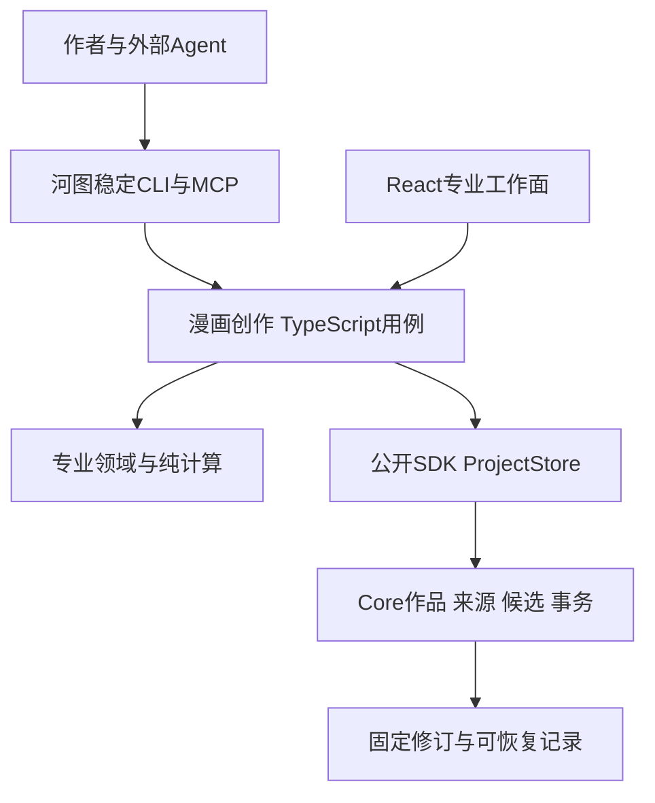
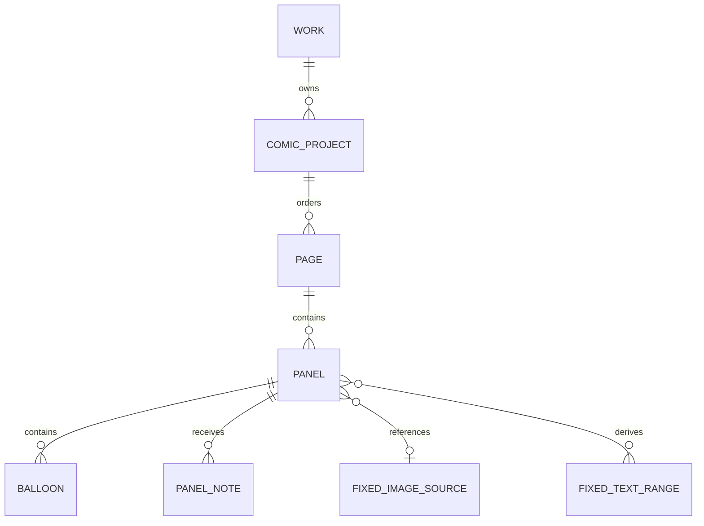

# 架构与领域设计

## 分层与技术选型

TypeScript实现领域不变量与专业用例；React展示审阅面；JSON Schema闭合输入；公开ProjectStore/SDK适配固定来源、CAS和原键。受管Node25执行插件后端，Cordis生命周期由宿主提供，插件不依赖其私有服务。Rust仅负责共享Core，不要求开发Rust扩展。

## 本体与Owner

页面、分格、气泡、图像固定来源、局部意见属于本插件，来源中的正文、素材和正式设定属于宿主。观察、规划、模拟、实际成果与作者决定分别表达。跨插件依据保存Owner、对象、修订和摘要；不同作品必须分别操作。

## 聚合与持久化

一个专业工程是一个聚合，具有格式版本、标题、专业记录及basis_refs；宿主扩展对象携带WorkRef、Owner、Schema版本和source_refs。保存形成不可变历史修订；不引入第二个数据库。大媒体由素材库持有，工程只保存固定来源索引。

## 关键不变量

漫画工程作为当前作品的专业成果，不新增宿主作品类型。分格和气泡使用规范化坐标，页面保存明确尺寸及左右阅读方向。示意格不冒充完成画面；图像只消费当前作品固定PNG/JPEG来源。HTML内嵌图像离线可读，未配图和越界单独检查，导出不表示作者认可。

遵守KISS与YAGNI：仅实现当前完整旅程所需结构；共享存取由公开SDK承担，专业算法不进入Core。

## 专业实体与关系

| 集合 | 领域角色 | 固定规则 |
| --- | --- | --- |
| pages | 页 | 明确尺寸、顺序及ltr／rtl阅读方向，按页组织实际阅读。 |
| panels | 格 | 属于具体页，规范化位置和尺寸、明确序号、固定故事选区及可空图像来源。 |
| balloons | 气泡 | 属于具体格，保存说话者、正文、气泡类型、顺序与格内规范化边界。 |
| notes | 局部意见 | 绑定格与规范化区域；随固定工程修订保存，旧意见不搬到新版图像。 |

代码字段与闭合Schema以[manifest](../contracts/plugin-manifest.json)为准；专业引用均属于一个固定工程修订，不跨作品共享写权限。

