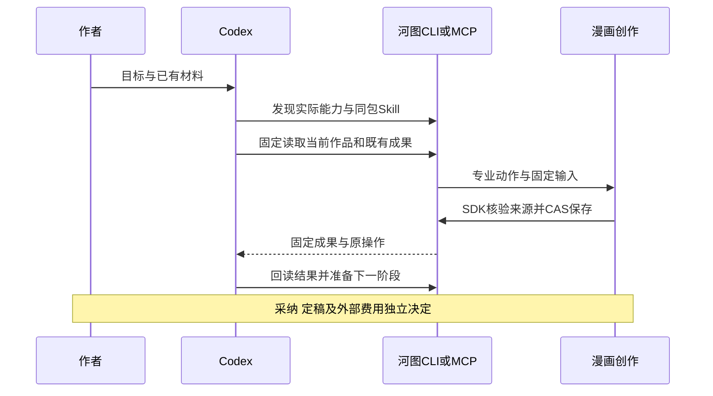

# Skill与机器协作

## 注册与发现

Skill随河图插件manifest声明，通过现有稳定CLI/MCP动态列出和按需读取；没有独立Codex插件、MCP服务或客户端工具名。安装/升级/启停后重新发现包和能力摘要。

## 方法要求

先读现有成果与来源，按实际覆盖组织本次目标；完成读取故事→页格规划→人物与图像职责→关联实际图像→气泡排版→阅读检查→区域意见→局部换图→固定交付。动作参数以发现Schema为准，方法不赋予额外权限。跨作品Agent分别读取，专业插件不得合并management_ref。

漫画工程作为当前作品的专业成果，不新增宿主作品类型。分格和气泡使用规范化坐标，页面保存明确尺寸及左右阅读方向。示意格不冒充完成画面；图像只消费当前作品固定PNG/JPEG来源。HTML内嵌图像离线可读，未配图和越界单独检查，导出不表示作者认可。

包内SKILL保持简洁，operations导航实际动作，workflows承接专业正反例；测试需要当前Codex连接真的读取方法并完成至少一次专业动作。
